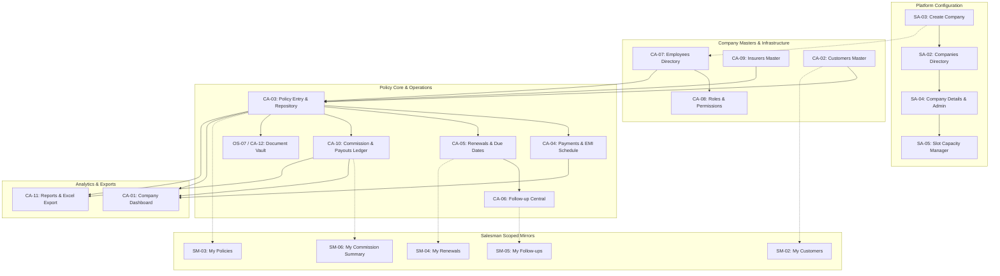

# Broker Workspace — Role-wise Panel & Functional Specification

**Document Version:** 1.0.0-PROPOSAL  
**Date:** October 2026  
**Stack Target:** Backend: Node.js + NestJS + TypeScript | Frontend: Responsive SPA with ProSurance Design System  
**Status:** PENDING EXPLICIT CLIENT & ARCHITECT APPROVAL (NO IMPLEMENTATION COMMENCED)

---

## 1. Executive Summary & Architecture Foundation

Broker Workspace is a multi-tenant Insurance Broker Management SaaS designed to replace manual records, diaries, and fragmented spreadsheets used by insurance brokerage firms in India.

### Architectural Ground Rules & Tenancy Isolation
1. **Multi-Tenancy Model:** Logical isolation with tenant identifier (`company_id` / `tenant_id`) enforced at database, ORM/query level, and API guard layer for all operational records.
2. **Super Admin Isolation:** The Platform Super Admin operates strictly at the platform infrastructure level (managing tenant companies, subscription status, slot capacities, global audit logs). Super Admin has **no default automatic operational access** to a tenant company's private customer records, policy files, or payout negotiations unless explicitly requested and permitted under an auditable emergency access protocol.
3. **Capacity Slot Definition:** As confirmed in requirements, "Slot Capacity" represents the combined count of operational employee seats (`Office Staff` + `Salesman` active users). Customers, policies, and insurer records do **not** consume seat slots.
4. **Financial Exactness:** All financial amounts (premiums, commissions, payouts) must be persisted as integers in minor currency units (Indian Paise / ₹1 = 100 paise) or `numeric(14, 2)` to eliminate IEEE 754 floating-point inaccuracies.
5. **No Fake Integrations or Fake Verification:** Payments, policy verification, and carrier endorsements record manual evidence or uploaded receipts honestly; the platform never falsely claims automated direct insurer core banking or IRDAI verification without real external integration.

---

## Deliverable A: Role-Wise Sidebar / Navigation Tree

### A.1 Role 1: Platform Super Admin (Platform Scope — 6 Sections)
```
[Platform Super Admin]
├── 1. Platform Overview / Dashboard
│     └── System KPIs, Active Companies, Slot Utilization, Alert Feed
├── 2. Companies Directory
│     └── Filterable Company Master List, Status (Active, Suspended, Provisioning)
├── 3. Create Company
│     └── New Broker Workspace Onboarding Wizard (Company Info, Admin Account, Slot Allotment)
├── 4. Company Details & Administration
│     └── Company Profile, Assigned Company Admin, Primary Contacts, Plan Suspension/Activation
├── 5. Employee Slot Capacity & Access
│     └── Slot Allocation Manager, Slot Usage vs Cap, Overage Warnings, License Extension
└── 6. Platform Settings & Audit Logs
      └── Global Platform Config, Maintenance Mode, Platform-wide Admin Security Audit Logs
```

### A.2 Role 2: Company Admin (Full Company Workspace — 12 Sections)
```
[Company Admin]
├── 1. Company Dashboard
│     └── Executive Stats (Booked Premium, Due Renewals, Commission Balance, Team Production)
├── 2. Customers
│     └── Customer Master, Individual/Corporate Profiles, Policy Portfolios
├── 3. Policies
│     └── Policy Repository, New Policy Entry, Endorsements, Status Lifecycle
├── 4. Payments & EMI Records
│     └── Premium Instalments, Due/Overdue Schedules, Direct vs Broker Receipt Tracking
├── 5. Renewals & Due Dates
│     └── 30-Day Expiry Watch, Grace Period Tracker, Renewal Pipeline & Rollover
├── 6. Follow-ups & Reminders
│     └── Follow-up Call Ledger, Customer Touchpoints, Outcome Notes, Next Schedule
├── 7. Employees
│     └── Internal Staff & Sales Agent Directory, Seat Slot Consumption Tracker
├── 8. Roles & Permissions
│     └── RBAC Configuration, Permission Matrix per Role/User (Granular Override)
├── 9. Insurance Companies / Insurers
│     └── Insurer Directory (General & Life), Short Codes, Carrier Contacts, Active Status
├── 10. Commission & Payouts
│     └── Insurer Receivable Commission, Salesman Payable Ledger, Net Brokerage, Reconciliation
├── 11. Reports & Export
│     └── Month-wise/Date-wise Reports, Insurer Business, Sales Production, Excel Workbook Export
└── 12. Excel Import, Documents & Company Settings
      └── Bulk Policy/Customer Excel Import with Mapping & Preview, Private File Store, Company Branding
```

### A.3 Role 3: Office Staff (Permission-Controlled Operations — 8 Sections)
```
[Office Staff]
├── 1. My Dashboard / Today's Work
│     └── Operational Queue: Today's Due Instalments, Pending Follow-ups, Unassigned Uploads
├── 2. Customers
│     └── Customer Directory, View/Add/Edit Contacts (Strictly scoped to company)
├── 3. Policies
│     └── Policy Entries, Record Endorsements, Update Policy Parameters
├── 4. Payments & EMI Records
│     └── Record Instalment Payment Evidence, Payment Mode, Offline Receipt Reference
├── 5. Renewals & Due Dates
│     └── Upcoming Renewals Follow-up, Lapse Logging, Renewal Creation Link
├── 6. Follow-ups
│     └── Activity Log: Phone Calls, Customer Responses, Scheduled Next Actions
├── 7. Documents
│     └── Policy PDF Upload, KYC Document Tagging, Scanned Endorsements
└── 8. Import / Reports (Permission Gated)
      └── Only rendered if explicitly granted by Company Admin (Default: Hidden/Locked)
```

### A.4 Role 4: Salesman / Employee (Assigned-Record Access — 7 Sections)
```
[Salesman / Employee]
├── 1. My Dashboard
│     └── Personal Production KPIs: Active Policies, Renewals Due, Pending Earnings
├── 2. My Customers
│     └── Customers linked to the logged-in Salesman's book of business
├── 3. My Policies
│     └── Policies where salesman is the assigned agent of record
├── 4. My Renewals & Due Dates
│     └── Upcoming expirations and overdue instalment alerts for assigned book
├── 5. My Follow-ups
│     └── Assigned customer call schedules, task logs, client notes
├── 6. My Commission / Payout Summary
│     └── Earned Commission, Paid Disbursements, Outstanding Payable Balance (Own records only)
└── 7. My Profile & Documents
      └── Agent Profile, KYC/License Details, Internal Broker Agreement
```

---

## Deliverable B: Complete Screen Inventory

| Screen ID | Section Name | Role Access | View Type | Key Modals / Secondary States |
|---|---|---|---|---|
| **SA-01** | Platform Overview | Super Admin | Dashboard | Date Range Selector, Alert Banner |
| **SA-02** | Companies Directory | Super Admin | List / Filter | Suspend Company Modal, Reactivate Modal |
| **SA-03** | Create Company | Super Admin | Multi-step Wizard | Confirmation Dialog, Admin Credentials Generated |
| **SA-04** | Company Details & Admin | Super Admin | Detail / Tabbed | Reset Admin Password Modal, Change Plan Modal |
| **SA-05** | Employee Slot Manager | Super Admin | List & Editor | Adjust Slot Quota Modal, Usage Warning Toast |
| **SA-06** | Platform Settings & Logs | Super Admin | List / Settings | Global Setting Edit Modal, Raw Audit Log Inspector |
| **CA-01** | Company Dashboard | Company Admin | Dashboard | Insurer Breakdown Chart, Quick Action Trigger |
| **CA-02** | Customer Master | Company Admin | List / Detail | Add/Edit Customer Modal, Duplicate Mobile Warning |
| **CA-03** | Policy Repository | Company Admin | List / Detail | New Policy Form, Archive/Cancel Modal |
| **CA-04** | Payments & EMI Records | Company Admin | List / Schedule | Record Payment Modal, Adjust Instalment Schedule |
| **CA-05** | Renewals & Due Dates | Company Admin | List / Tabs | Mark Renewed (Link Policy), Mark Lapsed (Reason) |
| **CA-06** | Follow-up Central | Company Admin | List / Agenda | Add Follow-up Modal, Schedule Next Action |
| **CA-07** | Employee Directory | Company Admin | List / Detail | Add Employee Modal (Slot Check), Disable Employee |
| **CA-08** | Roles & Permissions | Company Admin | Matrix Editor | Custom Role Builder, Permission Override Modal |
| **CA-09** | Insurers Master | Company Admin | List / Detail | Add/Edit Insurer Modal, Deactivation Warning |
| **CA-10** | Commission & Payouts | Company Admin | Financial Ledger | Record Insurer Payout, Record Salesman Disbursement |
| **CA-11** | Reports & Exports | Company Admin | Analytics / List | Export Progress Modal, Custom Filter Builder |
| **CA-12** | Imports & Company Config | Company Admin | Tool / Settings | File Upload Zone, Column Mapping, Dry-Run Preview |
| **OS-01** | Staff Dashboard / Queue | Office Staff | Dashboard | Daily Task Checklist, Reminder Snooze |
| **OS-02** | Staff Customers | Office Staff | List / Detail | Add Customer Modal (if permitted) |
| **OS-03** | Staff Policies | Office Staff | List / Detail | Add/Edit Policy Entry Modal |
| **OS-04** | Staff Payments & EMIs | Office Staff | List / Action | Record Customer Payment Evidence Modal |
| **OS-05** | Staff Renewals | Office Staff | List / Status | Follow-up Status Update Modal |
| **OS-06** | Staff Follow-ups | Office Staff | List / Form | Log Call Outcome Modal |
| **OS-07** | Staff Document Vault | Office Staff | Grid / List | Upload PDF File Picker, Association Modal |
| **OS-08** | Staff Reports (Gated) | Office Staff | Filtered List | Export Warning Modal (Permission Enforced) |
| **SM-01** | Salesman Dashboard | Salesman | Dashboard | Target Tracker, Expiring Soon Alerts |
| **SM-02** | My Customers | Salesman | Filtered List | View Customer Sheet, Add Lead/Customer Modal |
| **SM-03** | My Policies | Salesman | Filtered List | Policy Detail Drawer (Restricted Financials) |
| **SM-04** | My Renewals | Salesman | Filtered List | Direct Call Trigger, Renewal Pledge Modal |
| **SM-05** | My Follow-ups | Salesman | Task List | Log Customer Note Modal |
| **SM-06** | My Commission Summary | Salesman | Statement | Payout Transaction History, Request Statement |
| **SM-07** | My Profile & Documents | Salesman | Detail / Profile | Update Personal Details, View Agent Contract |

---

## Deliverable C: Screen-by-Screen Deep Specification

### C.1 Platform Super Admin Screens

#### SA-01: Platform Overview / Dashboard
- **Purpose:** Monitor multi-tenant SaaS health, platform-wide tenant count, active users against global resources.
- **Fields / KPIs:** Total Companies, Active Companies, Suspended Companies, Total Paid Slots vs Consumed Slots, Platform Error Count (24h).
- **Actions:** Quick filter by company status; Navigate to Companies Directory; Trigger Platform Health Diagnostics.
- **Filters:** Timeframe (Last 7d, 30d, 90d, All Time).
- **Validation:** None (read-only aggregate).
- **States:**
  - *Loading:* Skeleton cards for 5 stat boxes and chart placeholder.
  - *Error:* Banner: "Unable to load platform aggregate statistics. Retry connection."
  - *Empty:* Shown when 0 companies exist: "No tenant companies onboarded yet. Create your first company."

#### SA-02: Companies Directory
- **Purpose:** Search and administer all broker workspaces on the platform.
- **Fields:** Company Name, Tenant Subdomain/Slug, Admin Name & Email, Slot Quota (Used / Total), Registration Date, Status (`ACTIVE`, `SUSPENDED`, `TRIAL`).
- **Actions:** Search, Filter, "Create Company" button, Row Action: "Manage", "Suspend / Activate".
- **Filters:** Status dropdown (`All`, `Active`, `Suspended`), Text Search (Name, Email, Slug).
- **Validation:** Suspension requires mandatory reason text (minimum 10 characters).
- **States:**
  - *Loading:* Table row skeletons (5 rows).
  - *Error:* Error state card with retry action.
  - *Empty:* "No companies found matching the selected filter."

#### SA-03: Create Company
- **Purpose:** Provision a new tenant workspace and designate the initial Company Admin account.
- **Fields:**
  - *Company Profile:* Company Legal Name (required, min 3 chars), Short Code / Slug (alphanumeric lowercase, unique), Business Address, Official Phone, Official Email.
  - *Admin User:* Admin Full Name, Admin Work Email (unique across platform users), Mobile Number.
  - *Quota Provisioning:* Allocated Employee Slots (Office Staff + Salesmen, integer >= 1).
- **Actions:** "Validate & Provision Tenant", "Cancel".
- **Validation:** Slug uniqueness check against reserved routes; valid email format; slot count >= 1; password auto-generated or temporary invite link dispatched.
- **States:**
  - *Loading:* Button disabled with spinner: "Provisioning tenant database partition and admin account..."
  - *Error:* Inline form errors on duplicate slug or email conflict.
  - *Success / Confirmation:* Modal showing generated temporary credentials or email invite status with copy-to-clipboard button.

#### SA-04: Company Details & Administration
- **Purpose:** Inspect a single company's structural settings and manage platform-level controls.
- **Fields:** Profile info, Tenant ID (UUID), Creation timestamp, Assigned Company Admin credentials status, Account Status toggle.
- **Actions:** Edit Company Metadata, Change Company Admin, Reset Admin MFA/Password, Suspend Workspace, Terminate Workspace.
- **Filters:** N/A.
- **Validation:** Company Admin cannot be removed without assigning an active replacement user.
- **States:**
  - *Loading:* Full-page tab skeleton.
  - *Error:* 404 state if tenant ID invalid.
  - *Empty:* N/A.

#### SA-05: Employee Slot Capacity & Access
- **Purpose:** Regulate and update the combined employee capacity limit (Office Staff + Salesman) for each tenant.
- **Fields:** Company Name, Active Staff Count, Active Salesman Count, Total Consumed Seats, Maximum Authorized Slots, Available Seats, Billing Tier.
- **Actions:** "Edit Slot Capacity" modal, "Export Capacity Ledger".
- **Validation:** Cannot reduce capacity below currently active employee count without first disabling active accounts.
- **States:**
  - *Loading:* Table skeleton.
  - *Empty:* "No tenant companies registered."
  - *Overage Warning:* Highlighted amber badge when `Consumed == Authorized`.

#### SA-06: Platform Settings & Audit Logs
- **Purpose:** Inspect immutable platform-level activity logs and maintain platform configuration parameters.
- **Fields:** Timestamp, Actor (`SUPER_ADMIN`), Target Tenant, Action Performed (e.g., `COMPANY_SUSPENDED`, `SLOT_INCREASED`), Source IP, Outcome.
- **Actions:** Filter logs, Export audit log to CSV, View raw JSON metadata diff.
- **Filters:** Date range, Action Type, Target Tenant.
- **Validation:** Read-only immutable log stream.

---

### C.2 Company Admin Screens

#### CA-01: Company Dashboard
- **Purpose:** Comprehensive broker business cockpit for executive monitoring of policies, revenues, and pipeline.
- **Fields / KPIs:**
  - Total Active Policies, Total Booked Premium (₹ in lakhs/crores), Renewals Due (Next 30 Days), Overdue Instalments Count.
  - Commission Receivable Balance (From Insurers), Commission Payable Balance (To Sales Team), Net Brokerage Yield.
  - Visual breakdown: Premium Booked by Insurer (Horizontal Bar Stack), Policy Distribution by Class (Motor, Health, Life, SME).
  - Recent Policy Activity feed (Last 10 entries).
- **Actions:** Quick links to "New Policy", "Bulk Import", "Renewals Due", "Export Summary".
- **Filters:** Period Filter (`This Month`, `Last Month`, `This Quarter`, `Current FY`, `Custom`).
- **States:**
  - *Loading:* Metric card skeleton with shimmering bars.
  - *Empty:* Zero-state guidance cards: "Welcome to your new Broker Workspace. Start by adding your Insurers and Customers."

#### CA-02: Customer Master
- **Purpose:** Maintain complete customer records, contact information, and portfolio holdings.
- **Fields:** Customer ID, Full Name, Primary Mobile Number, Secondary Phone, Email Address, City/Town, Postal Code, Date of Birth, Created Date, Active Policies Count.
- **Actions:** Search, Filter, "New Customer" modal, Row Action: "View Profile & Policies", "Edit", "Archive".
- **Filters:** Search query (Name, Phone, Email, City), Policy Status Filter (Has Active Cover, No Active Cover).
- **Validation:**
  - Customer Name: Required, 2-100 characters.
  - Mobile Number: Required, 10-digit Indian standard. Non-blocking duplicate warning if mobile already exists in tenant database.
- **States:**
  - *Empty:* "No customers found. Click '+ New Customer' or import via Excel."
  - *Loading:* 10-row skeleton table.

#### CA-03: Policies (Policy Repository)
- **Purpose:** Central management of all insurance policies written across all carriers.
- **Fields:**
  - Policy Number (as issued by insurer), Customer (Lookup), Insurer (Lookup), Policy Class / Type (Motor, Health, Life, Fire, Marine, Liability, etc.), Salesman (Lookup).
  - Financials: Sum Insured / IDV (₹), Gross Premium (₹), Net Premium (₹), Tax / GST (₹).
  - Schedule: Start Date, Expiry / Renewal Date, Payment Frequency (`Yearly`, `Half-Yearly`, `Quarterly`, `Monthly`, `Single`, `Custom`).
  - Metadata: Vehicle Registration Number (for motor), Status (`ACTIVE`, `LAPSED`, `CANCELLED`, `EXPIRED`, `PENDING_RENEWAL`), Attached PDF Document indicator.
- **Actions:** "New Policy Entry", "Export Policies", Row Action: "View Detail Drawer", "Edit Policy", "Download PDF", "Log Renewal".
- **Filters:** Search (Policy No, Vehicle No, Customer Name), Insurer Filter, Policy Type Filter, Expiry Date Range, Salesman Filter.
- **Validation:**
  - Policy Number: Required, unique per insurer within tenant.
  - Dates: Expiry Date must be strictly after Start Date.
  - Premium: Must be positive integer/paise.
  - Motor policies require vehicle registration number format check.
- **States:**
  - *Empty:* "No policy records found. Click '+ New Policy' to create your first policy record."
  - *Loading:* Table row skeletons.

#### CA-04: Payments & EMI Records
- **Purpose:** Track every instalment schedule, capture payment evidence, and monitor overdue premiums.
- **Fields:** Policy Number, Customer Name, Instalment Number / Total (e.g. 2 of 4), Due Date, Grace End Date, Amount Due (₹), Status (`PENDING`, `PAID`, `OVERDUE`), Payment Evidence Mode (`DIRECT_TO_INSURER`, `BROKER_RECEIPT`), Payment Date, Bank/Cheque/Transaction Ref, Notes.
- **Actions:** Filter by Due Window, "Mark as Paid" modal, "Adjust Instalment Schedule", "Export Payment Schedule".
- **Filters:** Due Status (`Overdue`, `Due Today`, `Next 7 Days`, `Next 30 Days`, `Paid`), Carrier, Salesman.
- **Validation:** Mark Paid requires payment date (cannot be future date) and selected payment mode. No false bank clearing integration claimed.
- **States:**
  - *Empty:* "No instalments scheduled in the selected window."
  - *Overdue Alert:* Overdue items rendered with high-contrast red alert stamps.

#### CA-05: Renewals & Due Dates
- **Purpose:** Proactive renewal pipeline management to prevent policy lapse and customer attrition.
- **Fields:** Policy Number, Customer Name, Mobile Number, Insurer, Policy Type, Current Expiry Date, Days Remaining (Countdown / Overdue badge), Follow-up Call Count, Renewal Status (`UPCOMING`, `CONTACTED`, `IN_DISCUSSION`, `RENEWED`, `LOST`).
- **Actions:** "Log Follow-up", "Mark Renewed" (opens linked policy pre-filled modal), "Mark Lost" (mandatory reason code).
- **Filters:** Window (`Expiring in 7 Days`, `15 Days`, `30 Days`, `60 Days`, `Expired / Overdue`).
- **Validation:** Marking renewed requires linking the newly issued policy number.

#### CA-06: Follow-ups & Reminders
- **Purpose:** Diary-replacement tracking of customer interaction calls, visit notes, and scheduled callbacks.
- **Fields:** Customer, Linked Policy, Date & Time, Contacted By (Staff/Salesman Name), Channel (`PHONE`, `WHATSAPP_MANUAL`, `IN_PERSON`, `EMAIL`), Result (`ANSWERED`, `CALLBACK_REQUESTED`, `PROMISE_TO_PAY`, `NOT_REACHABLE`), Discussion Notes, Next Follow-up Date.
- **Actions:** "New Follow-up Entry", "Mark Done", "Reschedule".
- **Filters:** Assigned Staff/Salesman, Outcome, Due Date (Today, Overdue, Upcoming).
- **Validation:** Next Follow-up Date cannot be prior to current date.

#### CA-07: Employees Directory
- **Purpose:** Manage staff and sales agent profiles within the allocated slot capacity.
- **Fields:** Employee Code, Full Name, Role (`OFFICE_STAFF`, `SALESMAN`), Phone, Email, Default Commission Rate (%), Active Status, Linked User Login.
- **Capacity Indicator Widget:** "Slots Used: 8 / 10 (2 Available)".
- **Actions:** "Add Employee" modal (blocked if `Slots Used >= Slot Quota`), "Edit Details", "Deactivate Employee", "Reset Password".
- **Validation:** Total active employees cannot exceed tenant's `max_slots`. Deactivating releases one slot immediately.

#### CA-08: Roles & Permissions
- **Purpose:** Fine-grained Role-Based Access Control configuration and individual permission overrides.
- **Fields:** Role Name, Base Template (`OFFICE_STAFF`, `SALESMAN`), Module-by-module permission toggles (View, Create, Edit, Archive, Export, Financial View).
- **Actions:** "Save Matrix", "Create Custom Role", "Revert to Default".
- **Validation:** Cannot revoke Company Admin's master administration privileges.

#### CA-09: Insurance Companies / Insurers
- **Purpose:** Maintain carrier relationships, short codes, carrier contacts, and active underwriting relationships.
- **Fields:** Insurer Name, Short Code (e.g. `HERGO`, `ICICIL`, `NIA`), Carrier Class (`GENERAL`, `LIFE`, `STANDALONE_HEALTH`), Primary Contact Person, Official Phone, Email, Active Status, Total Policies Placed.
- **Actions:** "New Insurer", "Edit Insurer", "Activate / Deactivate".
- **Validation:** Deletion is strictly prohibited if insurer has existing linked policies. Deactivation hides from new policy creation dropdowns.

#### CA-10: Commission & Payouts
- **Purpose:** Complete dual-sided brokerage ledger: Insurer Receivable and Salesman Payable.
- **Fields:**
  - *Insurer Side:* Policy Number, Insurer, Gross Premium, Expected Commission % & Amount, Received Amount, Received Date, Remittance Reference, Outstanding Receivable.
  - *Salesman Side:* Salesman Name, Agreed Commission % & Amount, Paid Amount, Payment Date, Payment Reference, Balance Payable.
  - *Net Broker Margin:* Expected Insurer Commission minus Salesman Commission.
- **Actions:** "Record Insurer Receipt", "Record Salesman Disbursement", "Generate Commission Statement", "Export Ledger".
- **Filters:** Insurer, Salesman, Status (`Pending Both`, `Insurer Paid / Agent Unpaid`, `Fully Settled`).
- **Validation:** Amount paid cannot exceed remaining balance without supervisor override note.

#### CA-11: Reports & Export
- **Purpose:** Month-wise and date-wise business performance analytics and multi-sheet Excel generation.
- **Fields:** Date Range Selector, Report Type (`Upcoming Policies`, `Pending Dues`, `Customer Directory`, `Salesman Production`, `Insurer-wise Distribution`).
- **Actions:** "Preview on Screen", "Export Current View (Excel)", "Export Comprehensive Master Workbook (Multi-tab XLSX)".
- **Validation:** Date range must not exceed 365 days per synchronous report run.
- **Security:** Server-side sanitization of CSV/Excel cells starting with `=`, `+`, `-`, `@` to prevent Formula Injection (CSV Injection).

#### CA-12: Excel Import, Documents & Company Settings
- **Purpose:** Bulk spreadsheet onboarding, private document vault settings, and tenant branding.
- **Sub-sections:**
  1. *Excel Importer:* Upload Excel/CSV file -> Select Entity (`Policies`, `Customers`) -> Header Mapping Interface -> Dry-run Validation Table with row-level error breakdown -> Commit Import.
  2. *Document Storage Settings:* Allowed extensions (`PDF`, `JPG`, `PNG`), max file size limit (default 10MB).
  3. *Company Branding:* Company Display Name, Office Address, Support Contact, Header Logo Upload.
- **Validation:** Excel import validates mandatory fields, duplicate detection, and invalid foreign keys (e.g., non-existent insurer code) before any row is committed.

---

### C.3 Office Staff Screens

#### OS-01: Staff Dashboard / Today's Work
- **Purpose:** Operational workbench for daily data maintenance and pending tasks.
- **Components:** Today's Due Instalments checklist, Pending Follow-up Calls, Policies Expiring in 7 Days, Policies Missing PDF Documents.
- **Actions:** Check off task, jump to policy entry.

#### OS-02: Staff Customers
- **Purpose:** Look up customer details and create new customer profiles.
- **Fields & Filters:** Matches Customer Master (read & create enabled; delete/archive disabled).
- **Actions:** "Add Customer", "Search Customer", "View Customer Policy History".

#### OS-03: Staff Policies
- **Purpose:** Enter newly written policies, attach PDFs, and review policy terms.
- **Permissions:** View, Add, Edit allowed. Hard-deletion and cancellation forbidden.
- **Financial Masking:** Salesman payout commission and Insurer commission rates are **hidden** from Office Staff by default unless specifically granted.

#### OS-04: Staff Payments & EMIs
- **Purpose:** Record evidence of customer payments for upcoming or overdue instalments.
- **Fields & Actions:** View payment schedule, "Record Payment" button (captures date, mode, receipt number, note).

#### OS-05: Staff Renewals
- **Purpose:** Work through upcoming renewal accounts, call customers, and note renewal intent.
- **Actions:** Update renewal stage (`Contacted`, `Quote Sent`, `Awaiting Payment`).

#### OS-06: Staff Follow-ups
- **Purpose:** Log customer call outcomes and maintain daily conversation records.
- **Actions:** "Add Call Log", "Schedule Callback".

#### OS-07: Staff Document Vault
- **Purpose:** Upload and view policy PDF schedules, endorsements, and customer vehicle/KYC scans.
- **Actions:** Drag-and-drop PDF upload, associate to Policy ID, verify uploaded preview.

#### OS-08: Staff Reports (Gated)
- **Purpose:** Operational list exports (Customer phone list, Renewal list).
- **Behavior:** If Admin has disabled "Export / Reports" for Office Staff role, this section is completely absent from navigation and API returns `403 Forbidden`.

---

### C.4 Salesman / Employee Screens

#### SM-01: Salesman Dashboard
- **Purpose:** Personal agent production cockpit.
- **KPIs:** My Active Customers, My Policies In-Force, Policies Expiring This Month, My Commission Earned This Month (₹), My Pending Commission Disbursement (₹).
- **Alerts:** Due renewals in my customer base requiring immediate client contact.

#### SM-02: My Customers
- **Scope:** Scoped strictly to customers where `policy.salesman_id == current_user.salesman_id` or `customer.created_by == current_user.id`.
- **Actions:** Search my customers, View customer policy list, Add new customer (if permission granted).

#### SM-03: My Policies
- **Scope:** Scoped strictly to policies where the logged-in agent is credited.
- **Fields Displayed:** Policy Number, Customer Name & Mobile, Insurer, Policy Type, Sum Insured, Premium, Expiry Date, Document Status.
- **Restricted Fields:** Insurer commission earned by broker is strictly hidden. Only the salesman's own approved commission percentage and amount are visible.

#### SM-04: My Renewals & Due Dates
- **Purpose:** Enable the salesman to retain their own client book and ensure on-time renewals.
- **Actions:** Click-to-call mobile number, record customer commitment, notify office staff of renewal payment.

#### SM-05: My Follow-ups
- **Purpose:** Personal agenda of scheduled client touchpoints and follow-up callbacks.
- **Actions:** Add personal note, complete follow-up task.

#### SM-06: My Commission / Payout Summary
- **Purpose:** Personal financial ledger providing transparent accounting of earnings.
- **Fields:** Policy Number, Customer Name, Policy Issue Date, Premium (₹), My Commission Rate (%), Commission Earned (₹), Payout Status (`UNPAID`, `PARTIALLY_PAID`, `SETTLED`), Disbursed Amount (₹), Payment Date, Broker Ref No.
- **Total Banner:** Total Earned | Total Received | Outstanding Balance.
- **Restrictions:** Read-only ledger. Salesman cannot edit financial records.

#### SM-07: My Profile & Documents
- **Purpose:** View agent credentials, code, phone, and download broker agreement / commission policy document.

---

## Deliverable D: Role-Permission Matrix

| Functional Module / Action | Platform Super Admin | Company Admin | Office Staff (Default) | Office Staff (Permitted) | Salesman (Default) |
|---|:---:|:---:|:---:|:---:|:---:|
| **Tenant / Company Management** | **FULL** | NONE | NONE | NONE | NONE |
| **Slot Allocation & Capacity** | **FULL** | VIEW | NONE | NONE | NONE |
| **Platform Audit Logs** | **FULL** | NONE | NONE | NONE | NONE |
| **Company Dashboard** | NONE | **FULL** | NONE | NONE | NONE |
| **Staff Dashboard / Queue** | NONE | VIEW | **FULL** | **FULL** | NONE |
| **Salesman Dashboard** | NONE | VIEW | NONE | NONE | **OWN** |
| **Customer Master: View** | NONE | **ALL** | **ALL** | **ALL** | **ASSIGNED** |
| **Customer Master: Create** | NONE | YES | YES | YES | OPTIONAL |
| **Customer Master: Edit** | NONE | YES | YES | YES | ASSIGNED |
| **Customer Master: Archive/Delete** | NONE | YES | NO | NO | NO |
| **Policy Repository: View** | NONE | **ALL** | **ALL** | **ALL** | **ASSIGNED** |
| **Policy Repository: Create/Edit** | NONE | YES | YES | YES | NO / PROPOSAL |
| **Policy Repository: Cancel/Archive** | NONE | YES | NO | NO | NO |
| **Payments / EMIs: View Schedule** | NONE | **ALL** | **ALL** | **ALL** | **ASSIGNED** |
| **Payments / EMIs: Record Paid** | NONE | YES | YES | YES | NO |
| **Renewals: View & Update** | NONE | **ALL** | **ALL** | **ALL** | **ASSIGNED** |
| **Follow-up Ledger: View/Log** | NONE | **ALL** | **ALL** | **ALL** | **ASSIGNED** |
| **Insurers Master: View** | NONE | **ALL** | VIEW | VIEW | VIEW |
| **Insurers Master: Create/Edit** | NONE | YES | NO | NO | NO |
| **Employee & User Admin** | NONE | **FULL** | NONE | NONE | NONE |
| **RBAC & Permission Overrides** | NONE | **FULL** | NONE | NONE | NONE |
| **Insurer Commission: View** | NONE | **YES** | **NO** | OPTIONAL | **NO** |
| **Insurer Commission: Edit/Receive**| NONE | **YES** | **NO** | NO | **NO** |
| **Salesman Commission: View All** | NONE | **YES** | **NO** | OPTIONAL | **NO (OWN ONLY)**|
| **Salesman Commission: Record Pay**| NONE | **YES** | **NO** | NO | **NO** |
| **Excel Master Workbook Export** | NONE | **YES** | **NO** | OPTIONAL | **NO** |
| **Excel Export: Scoped Views** | NONE | **YES** | **NO** | YES | **OWN ONLY** |
| **Excel Bulk Importer (Data Load)**| NONE | **YES** | **NO** | OPTIONAL | **NO** |
| **Policy PDF Upload / Replace** | NONE | YES | YES | YES | NO |
| **Policy PDF Download / View** | NONE | YES | YES | YES | ASSIGNED |

---

## Deliverable E: Data Ownership & Tenant-Isolation Matrix

```
                    ┌──────────────────────────────────────────────┐
                    │            Platform Super Admin              │
                    │   Operates strictly on Global Control Plane  │
                    │   (Tenants, Subscriptions, Slot Capacities)  │
                    └──────────────────────┬───────────────────────┘
                                           │
                        Isolates into Tenant Partitions
                                           │
         ┌─────────────────────────────────┴─────────────────────────────────┐
         ▼                                                                   ▼
┌─────────────────────────────────┐                         ┌─────────────────────────────────┐
│     Tenant Company A (DB)       │                         │     Tenant Company B (DB)       │
│  Tenant ID: 'tenant-aaa-111'    │                         │  Tenant ID: 'tenant-bbb-222'    │
│  Slot Quota: 10 Employees       │                         │  Slot Quota: 25 Employees       │
│                                 │                         │                                 │
│ ┌─────────────────────────────┐ │                         │ ┌─────────────────────────────┐ │
│ │ Company Admin               │ │                         │ │ Company Admin               │ │
│ │ (Unrestricted Tenant Scope) │ │                         │ │ (Unrestricted Tenant Scope) │ │
│ └──────────────┬──────────────┘ │                         │ └──────────────┬──────────────┘ │
│                │                │                         │                │                │
│       ┌────────┴────────┐       │                         │       ┌────────┴────────┐       │
│       ▼                 ▼       │                         │       ▼                 ▼       │
│ ┌───────────┐     ┌───────────┐ │                         │ ┌───────────┐     ┌───────────┐ │
│ │  Office   │     │ Salesman  │ │                         │ │  Office   │     │ Salesman  │ │
│ │   Staff   │     │(Assigned) │ │                         │ │   Staff   │     │(Assigned) │ │
│ └───────────┘     └───────────┘ │                         │ └───────────┘     └───────────┘ │
└─────────────────────────────────┘                         └─────────────────────────────────┘
```

### Tenant Isolation Enforcement Rules:
1. **Database Schema & Row-Level Filtering:**
   - Every tenant-scoped entity (`Customer`, `Policy`, `Instalment`, `FollowUp`, `Insurer`, `Commission`, `Document`, `Employee`) contains a non-nullable indexed foreign key column `company_id UUID`.
   - In NestJS, a dedicated `TenantInterceptor` and Prisma/TypeORM query middleware automatically injects `WHERE company_id = request.user.companyId` on every SELECT, UPDATE, DELETE query.
2. **Horizontal Privilege Prevention:**
   - Attempting to access an entity belonging to another `company_id` produces a `404 Not Found` or `403 Forbidden` response and generates a high-severity security audit entry.
3. **Vertical Role Isolation (Within Tenant):**
   - **Salesman Row-Level Security:** Queries executed by a user with role `SALESMAN` automatically append `AND salesman_id = request.user.salesman_id` (except for unassigned lead pools where explicit permissions apply).
   - **Office Staff Column-Level Security:** Fields containing `insurer_commission_rate`, `insurer_commission_amount`, and `net_brokerage_yield` are stripped from response JSON DTOs via NestJS `ClassSerializerInterceptor` with permission groups.
4. **Physical Document Isolation:**
   - Uploaded PDF policy documents are stored with keys prefixed by tenant UUID: `/vault/{company_id}/policies/{policy_id}/{hash}.pdf`.
   - File downloads are served exclusively through short-lived signed URLs generated only after validating that the requesting user belongs to the specified `company_id` and has read permission for that policy.

---

## Deliverable F: Screen-to-API Mapping (NestJS + TypeScript Backend)

### F.1 Platform Super Admin Endpoints
| Screen ID | HTTP Method | Endpoint Route | Request Payload / Query Params | Expected Response Data |
|---|---|---|---|---|
| **SA-01** | `GET` | `/api/v1/super-admin/overview` | `?period=30d` | `{ totalCompanies, activeCompanies, totalSlots, usedSlots, recentTenants: [] }` |
| **SA-02** | `GET` | `/api/v1/super-admin/companies` | `?page=1&limit=20&status=ACTIVE&search=xyz` | `{ items: CompanySummaryDto[], total, page, pages }` |
| **SA-03** | `POST` | `/api/v1/super-admin/companies` | `CreateCompanyDto { name, slug, address, adminName, adminEmail, adminPhone, maxSlots }` | `{ companyId, slug, adminUserId, tempPasswordOrInviteToken }` |
| **SA-04** | `GET` | `/api/v1/super-admin/companies/:id`| Path param `:id` | `CompanyDetailDto { id, name, slug, status, maxSlots, admin: UserDto, createdAt }` |
| **SA-04** | `PATCH` | `/api/v1/super-admin/companies/:id/status` | `{ status: 'SUSPENDED' \| 'ACTIVE', reason: string }` | `{ id, status, updatedBy, updatedAt }` |
| **SA-05** | `PATCH` | `/api/v1/super-admin/companies/:id/slots` | `{ maxSlots: number, reason: string }` | `{ id, previousSlots, newMaxSlots, activeSlotsInUse }` |
| **SA-06** | `GET` | `/api/v1/super-admin/audit-logs` | `?page=1&limit=50&tenantId=uuid&action=xyz` | `{ logs: AuditLogDto[], total }` |

### F.2 Company Admin & Common Tenant Endpoints
| Screen ID | HTTP Method | Endpoint Route | Request Payload / Query Params | Expected Response Data |
|---|---|---|---|---|
| **CA-01** | `GET` | `/api/v1/dashboard/company` | `?period=current_month` | `{ activePolicies, bookedPremiumPaise, dueCount30d, insurerSplit: [], recentPolicies: [] }` |
| **CA-02** | `GET` | `/api/v1/customers` | `?page=1&limit=25&search=98200` | `{ items: CustomerDto[], total }` |
| **CA-02** | `POST` | `/api/v1/customers` | `CreateCustomerDto { name, mobile, email, city, dob, address }` | `CustomerDto` (with duplicate warning flag if phone exists) |
| **CA-03** | `GET` | `/api/v1/policies` | `?page=1&limit=25&insurerId=uuid&status=ACTIVE` | `{ items: PolicyListItemDto[], total }` |
| **CA-03** | `POST` | `/api/v1/policies` | `CreatePolicyDto { policyNumber, customerId, insurerId, salesmanId, type, sumInsuredPaise, premiumPaise, startDate, expiryDate, paymentFrequency, vehicleNumber }` | `PolicyDto` (creates linked instalment schedule automatically) |
| **CA-03** | `GET` | `/api/v1/policies/:id` | Path param `:id` | `PolicyDetailDto` (includes customer, insurer, salesman, instalments, documents, commission) |
| **CA-04** | `GET` | `/api/v1/payments/instalments`| `?window=next_30_days&status=PENDING` | `{ items: InstalmentScheduleDto[], totalOverdueAmount }` |
| **CA-04** | `POST` | `/api/v1/payments/instalments/:id/mark-paid` | `RecordPaymentDto { paidDate, paymentMode, transactionReference, notes }` | `InstalmentDto { id, status: 'PAID', paidDate, receiptId }` |
| **CA-05** | `GET` | `/api/v1/renewals` | `?window=30d&status=UPCOMING` | `{ items: RenewalListItemDto[], summaryCounts }` |
| **CA-05** | `POST` | `/api/v1/renewals/:policyId/rollover` | `RolloverPolicyDto { newPolicyNumber, newPremiumPaise, newStartDate, newExpiryDate }` | `{ previousPolicyId, newPolicy: PolicyDto }` |
| **CA-06** | `GET` | `/api/v1/follow-ups` | `?dueDate=today&status=PENDING` | `{ items: FollowUpDto[], countOverdue }` |
| **CA-06** | `POST` | `/api/v1/follow-ups` | `CreateFollowUpDto { customerId, policyId, channel, result, notes, nextFollowUpDate }` | `FollowUpDto` |
| **CA-07** | `GET` | `/api/v1/employees` | `?status=ACTIVE` | `{ items: EmployeeDto[], slotUsage: { used: 8, max: 10, available: 2 } }` |
| **CA-07** | `POST` | `/api/v1/employees` | `CreateEmployeeDto { name, role: 'OFFICE_STAFF' \| 'SALESMAN', email, phone, defaultCommissionRate }` | `EmployeeDto` (Throws `409 Conflict` if slot capacity exceeded) |
| **CA-08** | `GET` | `/api/v1/roles-permissions` | None | `{ roles: RoleDefinitionDto[], permissionCatalog: string[] }` |
| **CA-08** | `PUT` | `/api/v1/roles-permissions/:roleId` | `UpdateRolePermissionsDto { permissions: string[] }` | `RoleDefinitionDto` |
| **CA-09** | `GET` | `/api/v1/insurers` | `?activeOnly=false` | `{ items: InsurerDto[] }` |
| **CA-09** | `POST` | `/api/v1/insurers` | `CreateInsurerDto { name, shortCode, type: 'GENERAL' \| 'LIFE', contactPerson, phone }` | `InsurerDto` |
| **CA-10** | `GET` | `/api/v1/commissions/ledger` | `?salesmanId=uuid&reconciled=false` | `{ receivableSummary, payableSummary, items: CommissionLedgerRowDto[] }` |
| **CA-10** | `POST` | `/api/v1/commissions/payout-salesman` | `SalesmanPayoutDto { policyId, amountPaise, paymentDate, referenceNo, note }` | `SalesmanDisbursementDto` |
| **CA-11** | `POST` | `/api/v1/reports/export-excel` | `ExportRequestDto { reportType, dateFrom, dateTo, filters }` | Binary stream (`application/vnd.openxmlformats-officedocument.spreadsheetml.sheet`) |
| **CA-12** | `POST` | `/api/v1/imports/dry-run` | Multipart file upload + column mappings | `{ totalRows, validCount, errorCount, errors: [{ row: 12, field: 'insurerCode', reason: 'Not found' }] }` |
| **CA-12** | `POST` | `/api/v1/imports/commit` | `{ importSessionId: string }` | `{ importedCount: number, batchId: string }` |
| **Common**| `POST` | `/api/v1/policies/:id/documents`| Multipart file (`application/pdf`) | `{ documentId, fileName, fileSizeBytes, uploadedAt }` |
| **Common**| `GET` | `/api/v1/policies/:id/documents/:docId/download` | None | `{ downloadUrl: string, expiresInSeconds: 300 }` |

### F.3 Salesman Scoped Endpoints
| Screen ID | HTTP Method | Endpoint Route | Scoping / Filters Automatically Enforced |
|---|---|---|---|
| **SM-01** | `GET` | `/api/v1/salesman/dashboard` | Automatically filtered by `request.user.salesmanId` |
| **SM-02** | `GET` | `/api/v1/salesman/customers` | Scoped to customers with policies linked to salesman |
| **SM-03** | `GET` | `/api/v1/salesman/policies` | Scoped to policies where `salesman_id == current_user` |
| **SM-04** | `GET` | `/api/v1/salesman/renewals` | Scoped to salesman's portfolio expiring within 60 days |
| **SM-05** | `GET` | `/api/v1/salesman/follow-ups`| Personal assigned follow-up entries |
| **SM-06** | `GET` | `/api/v1/salesman/commission-statement` | Returns only own earned and disbursed amounts |

---

## Deliverable G: Module & Screen Dependency Map



### Dependency Rules:
1. **Policy Creation Prerequisite:** A policy record cannot be initialized without at least one valid Customer (`CA-02`), one active Insurer (`CA-09`), and one active Salesman (`CA-07`).
2. **Payment Schedule Derivation:** Saving a policy (`CA-03`) automatically calculates and writes the child `Instalment` records (`CA-04`) according to the selected `paymentFrequency`.
3. **Commission Ledger Entry:** Saving a policy (`CA-03`) automatically creates the associated expected commission record in `CA-10` based on the active commission terms or manual admin override.
4. **Renewal Continuity:** A renewal action on `CA-05` forks a new linked policy in `CA-03`, retaining the previous policy ID as `renewed_from_policy_id` for historical policy lineage.
5. **Employee Slot Enforcement:** Creation of any user with role `OFFICE_STAFF` or `SALESMAN` on `CA-07` queries the tenant's current active count against `tenant.max_slots` configured on `SA-05`.

---

## Deliverable H: Unresolved Business Decisions & Assumptions Register

| Decision ID | Topic | Current State & Impact | Proposed Resolution | Status |
|---|---|---|---|:---:|
| **DEC-01** | **Customer Mobile Uniqueness** | If two customers have the same mobile (e.g. family members, spouse, SME partners), should the system reject or warn? | **PROPOSED:** Issue a prominent warning modal indicating existing customer name, but permit save (do not hard-block). | **PROPOSED** |
| **DEC-02** | **Instalment Overdue & Policy Lapse** | When an instalment passes its grace period (15/30 days) unpaid, does policy status automatically flip to `LAPSED`? | **PROPOSED:** Auto-tag instalment as `OVERDUE`. Tag policy as `AT_RISK_OVERDUE`, but require Admin/Staff manual confirmation before marking legal `LAPSED` status, since offline banker deposit verification may be in flight. | **PROPOSED** |
| **DEC-03** | **Salesman Customer Creation** | Can a Salesman create new customers directly, or can they only submit a lead/draft? | **CONFIRMED:** Salesman can create new customers if explicit toggle `can_create_customers` is enabled in their role permissions. | **CONFIRMED** |
| **DEC-04** | **Salesman Commission Trigger** | At what exact milestone does salesman commission become payable? (Upon policy creation vs after broker receives payment from insurer). | **PROPOSED:** System tracks two explicit states: `Earned` (accrued upon policy issuance) and `Payable` (unlocked when customer payment or insurer commission is verified). Admin can disburse at any time. | **PROPOSED** |
| **DEC-05** | **Super Admin Data Visibility** | Does Platform Super Admin have read access to client customer names or premium numbers? | **CONFIRMED:** Platform Super Admin operates at tenant management level only. Operational database records are partitioned and restricted from Super Admin screens. | **CONFIRMED** |
| **DEC-06** | **Slot Capacity Definition** | Does slot capacity include Customers or Policies? | **CONFIRMED:** Slots represent only internal human users (combined Office Staff + Salesmen). Customers and Policies are unlimited within database quota. | **CONFIRMED** |
| **DEC-07** | **Direct vs Broker Premium Payments** | How should payments made directly to insurer portals be verified? | **CONFIRMED:** The broker records payment evidence (mode, transaction ref, date, screenshot/receipt) honestly without claiming fictitious automated core-banking integration. | **CONFIRMED** |
| **DEC-08** | **TDS & GST on Brokerage** | Should TDS (Section 194D / Section 393(1) IT Act 2025) and GST be auto-deducted in ledger? | **PROPOSED:** Store optional TDS % and GST % fields in company commission settings as calculations, but do not perform automated tax filings in v1. | **PENDING** |
| **DEC-09** | **WhatsApp & SMS Notifications** | Are automated WhatsApp/SMS notifications in v1 scope? | **CONFIRMED:** Excluded from v1 as per SRS and Research doc (D12). Manual in-app reminder schedules and direct click-to-chat links provided instead. | **CONFIRMED** |

---

## Deliverable I: Traceability Map (Requirements, SRS & Figma References)

| Screen / Feature | SRS Document Reference | Requirements & Research Reference | Figma / ProSurance UI Reference |
|---|---|---|---|
| **SA-01 to SA-06 (Super Admin)** | SRS §1, §4 ("Super admin will create admin and slot", "Super Admin Dashboard") | R&R Doc §3 (D10), §6 (A2, A3) | Consistent with ProSurance Ink/Paper theme, clean typography and sidebar |
| **CA-01 (Company Dashboard)** | SRS §10, §14 ("Dashboard & Reports", "Basic Dashboard components") | R&R Doc §6 (F2), §10 ("Reused ideas from sample prototype") | ProSurance HTML `.stat-row`, `.barlist` by insurer, recent policy table |
| **CA-02, OS-02, SM-02 (Customers)** | SRS §7 ("Customer Master: Name, Mobile, Email, Vehicle, Link with policy") | R&R Doc §4 (B4, B5), §5.1, §9 | ProSurance HTML `renderCustomers()`, `.avatar-sm` design tokens |
| **CA-03, OS-03, SM-03 (Policies)** | SRS §8 ("Policy Entry & Management, Policy dates, Premium, Status") | R&R Doc §3 (D3, D5, D6), §4 (C1-C7), §9 | ProSurance HTML `renderPolicies()`, `.pill` active/due/expired tags |
| **CA-04, OS-04 (Payments & EMIs)** | SRS §8 ("Premium/financial information where applicable") | R&R Doc §3 (D4, D5), §4 (R1, R2, D1-D4) | ProSurance HTML renewal/status breakdown adapted with instalment schedules |
| **CA-05, OS-05, SM-04 (Renewals)** | SRS §11 ("Policy Renewal Reminder, 30 days, upcoming, pending") | R&R Doc §4 (D6, D7), §5.3 | ProSurance HTML `renderRenewals()`, 30-day split lists |
| **CA-06, OS-06, SM-05 (Follow-ups)**| SRS §11 ("Pending policies requiring attention") | R&R Doc §4 (R4, D5), §5.2 ("Daily follow-up log") | ProSurance HTML follow-up call action stamps and reminder buttons |
| **CA-07 (Employees & Slots)** | SRS §4, §9 ("Salesman Master", "Slot capacity") | R&R Doc §3 (D9, D10), §6 (A3, A6, B6) | ProSurance HTML `renderSalesmen()` extended to employee capacity |
| **CA-08 (Roles & Permissions)** | SRS §1 ("RBAC Required") | R&R Doc §6 (A4), §7 ("Roles and permissions proposal") | ProSurance HTML role switch mechanism formalized into enterprise RBAC |
| **CA-09 (Insurers Master)** | SRS §6 ("Insurance Company Master, Short code, Active/Inactive") | R&R Doc §4 (B1), §9 | ProSurance HTML `renderInsurers()`, General vs Life pills |
| **CA-10, SM-06 (Commissions)** | SRS §10 ("Salesman Commission Management, Manual & Auto") | R&R Doc §3 (D7, D8), §4 (E1-E7), §5.4 | ProSurance HTML `renderCommissions()`, `.barlist` payout progress |
| **CA-11, OS-08 (Reports & Export)**| SRS §15, §16 ("Excel Export, Monthwise and datewise reports") | R&R Doc §5.5, §6 (F3, F4) | ProSurance HTML `XLSX.writeFile()` multi-sheet export architecture |
| **CA-12, OS-07 (Docs & Import)** | SRS §13 ("Document Upload - Policy PDF") | R&R Doc §4 (C5), §9, §11 (Q24) | ProSurance HTML `renderDocuments()`, `.file-drop` zones |

---

## 8. Next Step & Confirmation Protocol

As explicitly mandated by the client instructions:
1. **No feature implementation or code execution has been started.**
2. **Review this complete functional specification.**
3. **Upon your explicit review and approval of the specification, architectural boundaries, and decision register, we will initiate the NestJS backend and frontend modules.**
